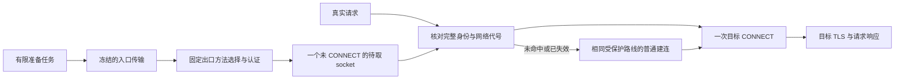

# 固定出口连接的预认证方案

目标是在不改变入口、固定出口、环境隔离和断网保护的前提下，减少**后续新连接**重复等待入口建连和出口认证的时间。准备工作提前进行；目标网站的 CONNECT、TLS 和响应等待仍然保留。

本文记录 2026-10-12 的方案与实现边界。Java 控制面已加入私有网络代号及配置字段，native 池已整合并构建两个 Android ABI；当前源码仍待实际 Android 或用户线路的性能验收。协议测试和 Python 实验不能替代这些验收。已有服务分层见 [网络架构](NETWORK-ARCHITECTURE.md)，现有测速策略见 [网络性能方案](NETWORK-PERFORMANCE-PLAN.md)。

## 先区分当前读数

| 读数 | 当前证据 | 能说明什么 |
| --- | --- | --- |
| 电脑 Clash 的入口 101 ms、出口 141 ms | 两张节点卡片的分别读数 | 需核对每张卡实际测试的 adapter、上游依赖、URL 和冷热状态；不能相加推导完整线路 |
| 应用完整线路 413 ms | `FixedExit/delay` 经入口与固定出口访问 gstatic | 是完整 adapter 链的请求测量；只有 trace 确认第二次连接复用时，才能称为复用请求延迟 |
| ChatGPT 首响应 3416 ms | 独立 `WebsiteCheck → WebProbeExit` 的 Java HTTPS HEAD | 包含代理、网站 TLS 与响应头等待；计时开始前内核已运行，不是应用启动耗时或模型生成耗时 |

电脑出口卡若确实配置了入口依赖，它的测量也可能包含上游；截图中的名称不能证明两端使用相同完整测试路径。对比需要保留相同入口及其传输参数、固定出口、目标 URL、DNS/IP 家族、预热状态，并分别记录第一次建立隧道与实际复用请求。本文不把这三组读数换算为预期收益。

## 准备到哪一步

普通新连接依次执行：

1. 通过选定入口建立到固定 SOCKS5 出口的传输。
2. 完成 SOCKS 方法选择及已有的用户名/密码认证。
3. 将当前目标域名和端口写入 SOCKS CONNECT。
4. 浏览器或下载客户端完成目标 TLS、发送请求、接收响应。

池中只允许保存完成第 2 步、**尚未写入目标 CONNECT** 的 socket。请求到达后取出一次，执行第 3、4 步。已经 CONNECT 到某个网站的流不能重新分配给另一个目标，也不能作为多个独立 TLS 会话的通用连接池。浏览器自身的 HTTP/2 连接复用继续由浏览器管理。

协议依据是 [RFC 1928 方法选择与请求](https://www.rfc-editor.org/rfc/rfc1928.html#section-3) 和 [RFC 1929 用户名/密码认证](https://www.rfc-editor.org/rfc/rfc1929.html#section-2)。实验源码把 `ClientHandshake` 拆为顺序执行的 `ClientAuthenticate` 与 `ClientCommand`，不合并阶段，不提前发网站请求。成功握手的字节与顺序保持兼容；命令回复检查版本、保留字段和 REP，非零 REP 返回对应 SOCKS 错误，不把拒绝视为成功，也不重试拒绝的命令。凭据长度策略沿用既有实现，不能宣称本轮新增了完整的认证字段验证。

## Native 池的约束

以下实现合同已经过原生本地测试，实际 Android 与发布验收另行记录：

- 只对程序生成的 `FixedExit` 开启；候选 `ProbeExit*`、`WebProbeExit`、普通外部代理及 UDP 路径保持原行为。
- 每个环境的内核独立持有池。最多一个待取 socket、一个有限准备任务；总期限最多 8 秒，从准备开始计时，包含认证等待。没有定时补满、合成保活或无限后台重试。
- 真实的非 URLTest TCP dial 成功后才允许有限准备。native 不能仅凭 HTTP 类型判断前台使用，也不能将这个条件描述为新增的前台许可。
- 准备与取出使用同一份冻结入口快照。只支持可确定实际叶子 adapter 的 `EntryChoice` 路径；不能先记录名称、再从可变选择器重新拨号。
- 身份包含环境/内核配置代次、实际出口 adapter 与入口父/叶 adapter 身份、选择器单调修订号、出口认证及 TLS 配置身份、私有默认网络代号。诊断只暴露摘要和计数，不输出凭据或控制密钥。
- 选择器 A → B → A 必须使旧 socket 失效。返回同一个名称或叶子不足以证明路由未变化；同名 provider 叶子被替换也需要失效。配置更新必须显式作废旧池，不能假设旧 adapter 总会收到 `Close`。
- 在准备完成、取出和 CONNECT 返回前重新核对身份。晚到的准备结果必须关闭真实 socket，不能进入新代次的池。
- 取消、过期、网络变化、核心重启、环境删除和配置变化清理未交付的 socket 及准备任务。已经交给浏览器的 H2/WSS 流继续沿用已有生命周期，不能因池失效而误关闭。

未命中或无效准备资源走原有受保护的冷建连路径。若实现允许关闭的预备 socket 触发一次冷建连补救，必须证明它发生在交付应用连接及应用数据前；REP 拒绝不得重试。交付后绝不重放 HTTP 请求或 Read/Write，不替换固定出口，不回退 DIRECT。调用方原有取消和 deadline 不能被准备任务覆盖。

## Java 默认网络代号与私有许可文件

当前 Java 实现由 `NetworkTransportService` 持有 `ExitPreconnectEpoch`，通过 Android 默认网络回调观察网络可用性、网络身份及 VPN 能力。每个环境的私有 `network-runtime/preconnect-network-epoch` 文件写入不含网络名称和凭据的 `ready:<UUID>` 或 `blocked:<UUID>`。

重复、相同的能力回调不更新代号；网络丢失再恢复到同一名称仍产生新代号，避免 A → B → A 借用旧准备资源。未知网络、回调注册失败和服务关闭采用 blocked 状态。写入使用同一对象锁及同目录临时文件的原子替换；失败使文件不可用，不制造 ready 代号。

回调只更新已有环境的已有文件，不能因为监听网络而创建未建立的环境目录，或复活已删除的环境。一个环境写入失败不能阻止其他环境失效。启动时若这项可选元数据不可写，关闭优化并继续原有受保护建连，不能因此破坏原本有效的网络启动。

`NativeNetwork.exit` 仅为 `FixedExit` 写入 `pocket-preconnect` 与 `pocket-preconnect-epoch-file`。这份私有文件只限制未使用的准备资源，**不是新的前台许可**，也不替代现有浏览器网络准入、手机 VPN 要求、出口核验或环境删除机制。Native 读取缺失、blocked 或不可确认的代号时应禁用准备资源；普通路径仍须经过已有保护。

## 测速保持原口径

Native URLTest 必须通过明确的内部 bypass 标记，既不取用池，也不触发补充准备。不能根据 HTTP metadata、延迟值相同或时间接近猜测它是业务请求。

`FixedExit` 的优化不会自动改变独立 `WebProbeExit` 的 ChatGPT 首响应。原生测速的首次/复测/复用 trace、候选监听器、固定出口核验和忙时取消仍保留。准备 socket 未发送目标 CONNECT，因此也不能被记为某个网站已预热或已验证成功。

## 上游能力与协议边界

研究时官方最新发布为 [Mihomo v1.19.32](https://github.com/MetaCubeX/mihomo/releases/tag/v1.19.32) 和 [sing-box v1.14.3](https://github.com/SagerNet/sing-box/releases/tag/v1.14.3)。项目随附 v1.19.31 的 VLESS、sing-mux、SOCKS5、Hysteria2、TUIC 五个 adapter 源文件与 v1.19.32 对应文件逐字节相同。这些传输能力已经存在，不需要用更换核心名称解释性能收益。

- [Mihomo VLESS 的 TCP/UDP 分支](https://github.com/MetaCubeX/mihomo/blob/v1.19.32/adapter/outbound/vless.go#L281) 只在 UDP 路径使用 XUDP；[sing-box VLESS 文档](https://github.com/SagerNet/sing-box/blob/v1.14.3/docs/configuration/outbound/vless.md) 同样将其定义为 UDP 编码。XUDP 标签不使当前网页 TCP 流变快。
- [Mihomo smux 配置](https://github.com/MetaCubeX/mihomo/blob/v1.19.32/adapter/parser.go#L234) 和 [sing-box multiplex](https://github.com/SagerNet/sing-box/blob/v1.14.3/docs/configuration/shared/multiplex.md) 已提供多路复用。服务端必须支持对应协议；不能向未知 VLESS 服务或普通 SOCKS 出口默认添加 mux。TCP mux 还需验证丢包、长回复与大下载并发时的延迟。
- [Hysteria2](https://github.com/MetaCubeX/mihomo/blob/v1.19.32/adapter/outbound/hysteria2.go#L128) / [TUIC](https://github.com/MetaCubeX/mihomo/blob/v1.19.32/adapter/outbound/tuic.go#L113) 可以在手机到入口这一段使用 QUIC，前提是有真实匹配的入口服务器、凭据及可用 UDP。入口 QUIC 仍能承载 TCP 到固定 SOCKS 出口，入口优化本身不要求出口支持 UDP。
- 网站端到端 HTTP/3 是另一件事，需要真实出口 UDP ASSOCIATE、入口 UDP 转发和浏览器实际 UDP 路径。[SOCKS UDP 路径](https://github.com/MetaCubeX/mihomo/blob/v1.19.32/adapter/outbound/socks5.go#L89) 与当前 TCP CONNECT 分开；设置一个 UDP/XUDP 开关不能证明全链支持。

## 已有证据与尚未完成的验收

### 独立 Python 协议实验

忽略目录 `work/exit-preauth-benchmark/` 保存 `benchmark.py`、`serve.py`、`README.md` 和原始 `results.json`。实验使用真实回环 TCP、两跳 SOCKS 认证、校验证书的目标 TLS 和 204 HEAD，但 fixture 人为加入入口建立 80 ms、入口各 SOCKS 阶段回复 15 ms、出口各阶段回复 35 ms。它测的是这些受控等待，不是用户 WAN RTT。

20 组 AB/BA 配对的请求耗时如下：

| 受控协议路径 | p50 | p95 |
| --- | --- | --- |
| 完整冷建立 | 249.84 ms | 259.97 ms |
| 已准备资源取出后 | 45.28 ms | 67.45 ms |

准备本身仍需约 201.30 ms 中位数；总 socket 工作量约为冷路径 249.23 ms、准备路径 247.02 ms。实验表明可以提前支付建连/认证等待，不能证明删除了这些成本，也不能推导应用的 413 ms 会降到上述结果。

该报告明确标记 `actualMihomoExecution=false`、`actualAndroidExecution=false`、`productionPoolImplemented=false`。其 30 项协议检查、socket 事件及 Python 池都不能当作正式 native 池的通过证据。

### Scratch SOCKS 协议测试

`work/network-preconnect-native/` 中的协议拆分使用实际 Mihomo 源码。普通测试与 `-race` 均通过 7 个顶层测试、31 个包含子测试的通过记录，覆盖成功 wire 一致、认证失败不写 CONNECT、REP 1–8 拒绝、截断/异常回复、地址家族和命令、真实双向流的认证后取用及直接丢弃。

这仅证明协议辅助方法及其测试，不能宣称 adapter 池、整个 Mihomo、Android 或用户网络已通过。

### Native 与发布证明：待补充

当前没有可引用的正式池性能通过记录。发布前需由真实 native 实现补充并绑定源码、构建产物和运行：

1. 同一个核心构建、入口、固定出口、目标、DNS/IP 家族与 TLS 条件，交替比较关闭/开启；分别保留准备耗时、提前量、冷请求、命中和未命中结果。
2. 用 native 连接 ID 与服务端实际 socket 事件关联认证完成、取出、目标 CONNECT、TLS 和响应。准备期间目标 CONNECT/HEAD 为零，单次取出只有一个目标请求。
3. 验证容量、8 秒过期、取消、延迟发布、选择器 A → B → A、同名 provider 更新、网络/VPN 变化、核心重启、删除环境、错误认证、REP 拒绝及目标 TLS 失败。
4. 明确证明 URLTest bypass；独立候选与网站探测不冒充业务命中，不改变原有测量口径。
5. 在 Android 验证环境之间不借用 socket、固定出口未变、失败不直连，已有 WSS/H2、上传和下载不中断；比较 CPU、内存、空闲 socket/电量、失败率及并发负载下的 p50/p95。
6. 发布证据列出真实 `sourceCommit`、源码/patch/核心 SHA、运行 ID/attempt、目标 ABI、测试报告 SHA 和实际执行标记。构建成功、host 协议检查或 Python 结果不能代填 Android/native 验收。

这项方案能减少命中时新请求的建连等待；首次冷连接、网站服务处理和物理线路延迟仍需单独测量。是否能改善用户当前线路，只能由同条件实测决定。
